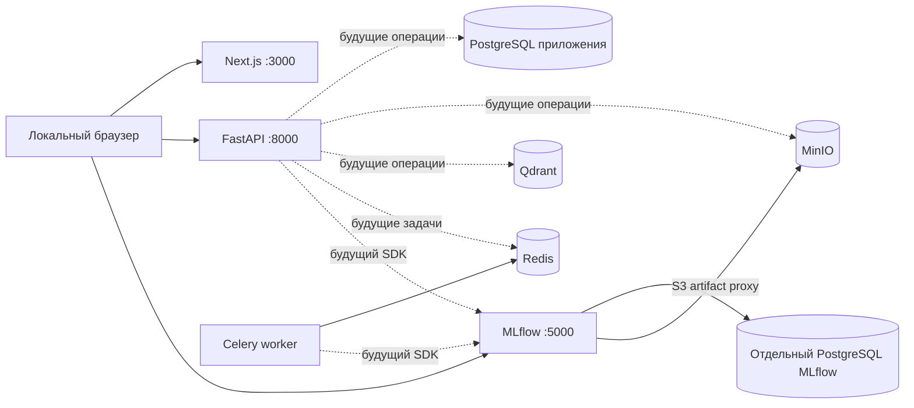

# Архитектура Medical AI

## Границы этапа 1

Этап 1 завершён по сообщению пользователя от 14 ноября 2026 года; базовый коммит
`c22fae1`. Ниже описана реализованная инфраструктура, а не функции этапа 2.
План дальнейшей разработки и вопросы согласования — в [CODEX_TASKS.md](CODEX_TASKS.md).

Целевая архитектура — модульный монолит FastAPI с Next.js и отдельными
инфраструктурными сервисами. Сейчас реализованы HTTP liveness, конфигурация
Celery и развёртывание сервисов. Нет таблиц предметной области, миграций
приложения, пользователей, auth, RAG, OCR, LLM Gateway и фоновых бизнес-задач.
Пустые каталоги будущих модулей не создаются.

## Дополнение этапа 2 — подготовлено, приёмка ожидается

Добавлен модуль `backend/app/auth`: пользователи, серверные сессии и лимиты входа
в PostgreSQL приложения через SQLAlchemy 2.x; Alembic запускается только вручную.
Пароли хешируются Argon2id. Токены сессий и CSRF случайные, в БД хранятся SHA-256
хеши; срок сессии абсолютный, по умолчанию 8 часов. Вход ротирует текущую сессию,
выход отзывает её на сервере. Другие устройства сохраняют свои сессии до истечения.

Next.js проксирует `/api/*` в существующий backend, браузер работает с одним origin.
Приватный layout проверяет сессию серверным запросом; API независимо использует
`AuthenticatedUser`. Будущие запросы данных обязаны фильтровать `user_id` по этой
зависимости; `require_owner` возвращает 404 для чужого ресурса. Роли администратора
и бизнес-ресурсы будущих этапов не вводятся заранее.

Сессия — host-only HttpOnly cookie, SameSite=Lax; Secure обязателен при HTTPS.
Для POST требуется точный `AUTH_ORIGIN` и CSRF cookie/header; для авторизованных
изменений токен дополнительно связан с серверной сессией. CORS не открывается.
Production auth отклоняет конфигурацию без HTTPS origin и Secure cookies.
MLflow, его БД, сети, тома и bootstrap не меняются. В Compose добавлена только
передача конфигурации PostgreSQL приложения и auth в существующие backend/worker.

Проверки, модель ограничений и ручная приёмка: [STAGE2.md](STAGE2.md).

## Сервисы и хранение

Код подэтапов 3.1–3.3 подготовлен, ручная приёмка ожидается. Текущие функции
Backend — auth и Document Ingestion; утверждения о «будущих документах» в описании
исходного этапа 1 ниже являются историческими. Инструкция: [STAGE3.md](STAGE3.md).

| Сервис | Данные | Постоянный том | Доступ с хоста |
| --- | --- | --- | --- |
| backend | liveness, auth, защищённый document API | нет | 127.0.0.1:8000 |
| frontend | Next.js | dev cache в слое контейнера; прежние dev-тома не подключены | 127.0.0.1:3000 |
| postgres | auth, документы, версии текста, transactional outbox | postgres-data | не опубликован |
| mlflow-db | эксперименты, runs, метрики, параметры, Registry | mlflow-db-data | не опубликован |
| minio | объекты и артефакты MLflow | minio-data | только Console 127.0.0.1:9001 |
| redis | broker DB 0, results DB 1, AOF | redis-data | не опубликован |
| worker | Celery ingestion, встроенный outbox dispatcher | нет | не опубликован |
| qdrant | будущие векторы и payload | qdrant-data | не опубликован |
| mlflow | Tracking UI/API, Registry, artifact proxy | в PostgreSQL и MinIO | 127.0.0.1:5000 |
| minio-init | одноразовый bootstrap bucket/account/policy | нет | не опубликован |

Volumes получают префикс `COMPOSE_PROJECT_NAME`. Его изменение подключит другой
набор томов. Контейнер MLflow stateless: SQLite и локальное файловое artifact
store не используются. Состояние PostgreSQL и MinIO нужно резервировать согласованно.

## Сети

- `web`: frontend и backend, без доступа frontend к хранилищам.
- `app-db` (internal): backend, worker, postgres.
- `mlflow-db` (internal): только mlflow и его отдельный PostgreSQL.
- `objects` (internal): MinIO, bootstrap, backend, worker и MLflow.
- `queue` (internal): Redis, backend и worker.
- `vectors` (internal): Qdrant, backend и worker.
- `tracking` (internal): будущие клиенты backend/worker и MLflow.
- `management`: MinIO и MLflow для локальной публикации UI.

Internal-сети не дают прямой выход наружу; multihomed-сервисы backend/MLflow/MinIO
также имеют обычную сеть. Это сегментация Compose, а не замена ACL или сетевой
политики production. PostgreSQL, Redis, Qdrant и S3 API MinIO не публикуются
на хост. Сервисы без реализованного ACL не допускают реальных пользователей.

## Document Ingestion — подэтапы 3.1–3.3

Модуль `app/documents` использует существующие `AuthenticatedUser`, CSRF и
серверные сессии. Все чтения/скачивание/retry выбирают документ по ID и owner_id;
чужой документ возвращает 404. Публичный API не раскрывает bucket/object key.
Ручной multipart-разбор начинается после auth/CSRF, принимает только одно поле
file и ограничивает фактическое тело до multipart-разбора, в том числе без
Content-Length. Временные файлы закрываются при ошибке и отключении клиента.

`documents` и `document_ingestion_jobs` создаются одной транзакцией до MinIO write:
сохранён server key, исходный SHA-256, размер и delayed pending outbox. После
подтверждения MinIO документ становится queued, available_at задания — текущим.
При сбое API не удаляет и не перезаписывает оригинал; по окончании grace worker
проверяет сохранённый key/размер/SHA-256. Если объекта нет — UPLOAD_INCOMPLETE.
При одинаковом owner/Idempotency-Key и содержимом возвращается прежний документ,
при другом содержимом — 409. Проверка квот сериализована блокировкой users row.

В существующем worker после `worker_ready` запускается dispatcher thread с
собственным engine. PostgreSQL SKIP LOCKED и короткий publishing lease позволяют
нескольким workers безопасно публиковать pending задания. Redis не является
источником статуса документа. Published без обработки и processing с истёкшим
lease возвращаются к публикации. Ошибки публикации/хранилища имеют ограниченный
budget; документ после исчерпания требует явного retry. Новых сервисов/beat нет.
Перед обработкой задача получает новый lease UUID. Результат принимается только
при совпадении неистёкшего lease; поздние и дублированные сообщения не создают
повторной версии текста. Version уникальна для документа; retry создаёт новую.

Worker сверяет оригинал и запускает `python -m app.documents.extract` как отдельный
процесс с timeout; на Linux дополнительно ограничены CPU/адресное пространство.
PyMuPDF извлекает PDF по страницам, python-docx — абзацы/таблицы в порядке OOXML.
Сохраняются NFC-текст, offsets по Unicode code points и локаторы page/block.
Без OCR пустые страницы PDF дают needs_ocr, частичный текст сохраняется.
DOCX ограничивается ZIP size/entry count, текстом и числом блоков; точное число
отрендеренных страниц DOCX без renderer не определяется. Внешние ссылки не
загружаются, JavaScript/макросы не выполняются. SDK/парсер не пишет тексты в логи.

Next.js сохраняет серверный private layout и существующий same-origin `/api`
rewrite. Tailwind v4 и локальные адаптированные shadcn/ui primitives обеспечивают
desktop sidebar и мобильный Radix Sheet, загрузку, список/пагинацию, polling,
скачивание, retry и безопасный plain-text просмотр. Next.js/React не обновлены.
MinIO bootstrap, MLflow и его policy/учётная запись не меняются.
Миграции 0001_auth/0002_documents в подэтапах 3.2–3.3 не изменены, новых нет.

## MLflow Tracking, Registry и артефакты

MinIO Server и Client собираются локально из официальных GitHub release assets,
без зависимости от Docker-репозиториев `minio/minio` и `minio/mc`. Версии сохранены:
server `RELEASE.2025-04-22T22-12-26Z`, client `RELEASE.2025-04-16T18-13-26Z`.
`infrastructure/minio/releases.json` фиксирует SHA-256 бинарных файлов для
Linux amd64/arm64. Build-time загрузчик на стандартной библиотеке Python
проверяет hash до установки; несовпадение, HTTP-ошибка или неподдерживаемая
архитектура останавливают сборку. Fallback на latest и сторонние зеркала отсутствует.
Базовый образ — уже используемый в проекте `python:3.12.12-slim-bookworm`.
Target `server` содержит оба бинарных файла, target `client` — только `mc` для
`minio-init`. Установка пакетов через apt/pip для этого не требуется.
Скачивание происходит при ручной сборке, не при старте сервисов в internal-сети.
Путь `/data`, root-пользователь контейнера, env, сети, healthcheck и том MinIO
сохранены; версия формата данных сервера не меняется.

`server.py` собирает SQLAlchemy URL из отдельных переменных с корректным
экранированием пароля, задаёт общий SQL backend для Tracking и Model Registry.
MLflow создаёт начальную служебную схему только при ручном запуске контейнера.
Обновление существующей схемы требует резервной копии и ручного `mlflow db upgrade`.

Artifact root новых экспериментов — `mlflow-artifacts:/`, физическое назначение —
`s3://${MLFLOW_ARTIFACT_BUCKET}/artifacts`. Tracking server обслуживает upload/download,
поэтому будущим клиентам достаточно Tracking URI; S3-секреты им не передаются.
MinIO init создаёт bucket и отдельного пользователя с policy только для него.
Доступ анонимных клиентов к bucket не включается. Root-секрет MinIO не передаётся
MLflow. При изменении bucket/endpoint уже записанные artifact URI автоматически
не переносятся.

Registry хранит версии, ссылки на run/artifact и метаданные в `mlflow-db`.
Он не загружает модели в память и не разворачивает inference. Будущие модели
и артефакты версионируются в Registry и MinIO; deployment — отдельный этап.

Настройки `MLFLOW_TRACKING_URI`, `MLFLOW_REGISTRY_URI`, `MLFLOW_EXPERIMENT_NAME`
передаются backend/worker как задел. MLflow SDK в приложение не добавлен,
эксперименты при старте не создаются. Будущая схема экспериментов:

| Область | Будущие параметры и метаданные | Будущие метрики |
| --- | --- | --- |
| LLM | provider, model/version, decoding config | latency, tokens, cost, quality |
| Embeddings | model/version, dimensions, dataset version | retrieval quality, throughput |
| RAG | chunking, index version, retrieval config | Recall@k, MRR, groundedness |
| Промпты | template version/hash, task, code commit | regression/evaluation scores |
| Evaluation | обезличенный dataset version, evaluator version | корректность и отказы |

Это план метаданных, а не реализованное логирование. Позднее MLflow Tracing
может связывать LLM-вызовы, retrieval и evaluation. Флаг приложения
`MLFLOW_TRACING_ENABLED=false` является резервом конфигурации, а не механизмом
защиты: отсутствие instrumentation обеспечивает отсутствие трассировки сейчас.
`MLFLOW_ENABLE_ASYNC_TRACE_LOGGING=false` меняет режим SDK, но не выключает tracing.
До интеграции нужны redaction, согласия, ACL, retention, удаление и запрет
записи медицинских текстов, промптов с персональными данными и ключей.

## Готовность и ограничения

Compose ожидает healthchecks хранилищ и успешный bootstrap MinIO; MLflow зависит
от `mlflow-db` и bootstrap. Backend/worker не зависят от MLflow: необязательное
отслеживание не должно блокировать основное приложение. Liveness API/UI
проверяет процесс, без ложного утверждения о проверке всех зависимостей.
Celery healthcheck проверяет ответ конкретного worker; Qdrant — `/readyz`.

Production override убирает dev mounts/reload, задаёт runtime targets,
ротацию контейнерных логов и часть ограничений прав. TLS, аутентификация UI,
защищённые секреты, backup/restore и проверки безопасности — обязательные
условия дальнейшего production-допуска, не выполненные на этапе 1.

Официальные источники конфигурации:
[MLflow server](https://mlflow.org/docs/latest/tracking/server/),
[artifact store](https://www.mlflow.org/docs/latest/self-hosting/architecture/artifact-store/),
[MLflow 3.15.0](https://mlflow.org/releases/3.15.0/),
[Next.js 16.4.5](https://github.com/vercel/next.js/releases/tag/v16.4.5),
[React changelog](https://github.com/react/react/blob/main/CHANGELOG.md).
Версии — фиксированная исходная конфигурация; проверка совместимости и аудит
не запускались. Документация latest может отличаться от зафиксированной версии.
